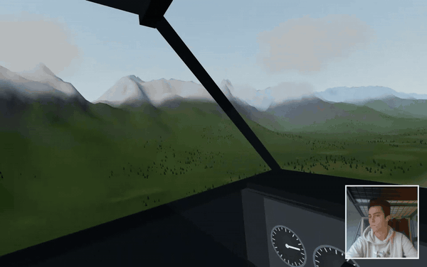
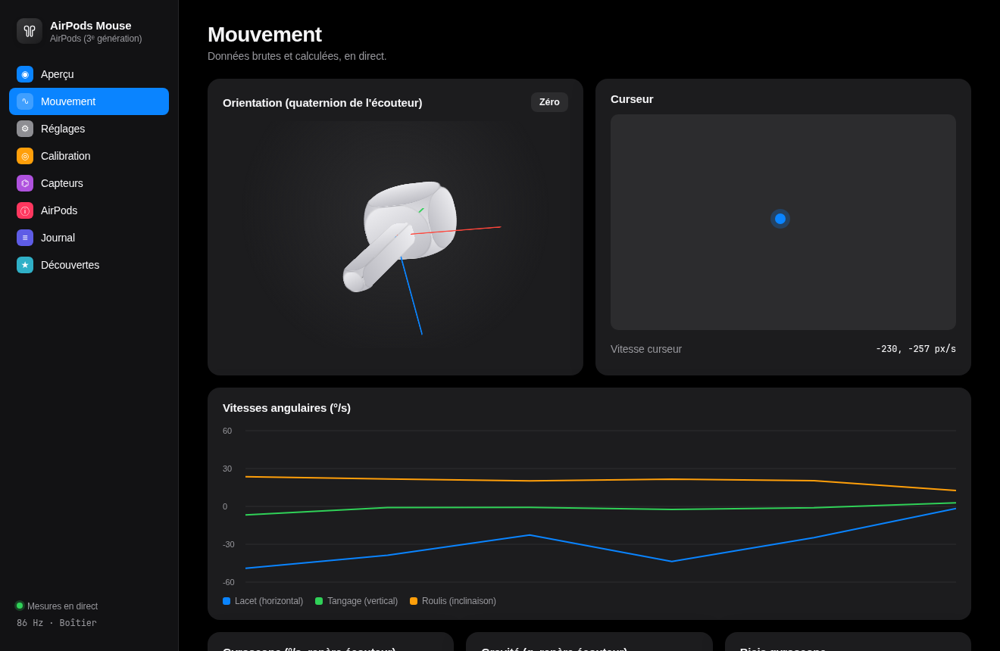

<p align="center">
  
</p>

<h1 align="center">MousePods</h1>

<p align="center">
  <b>Tes AirPods sont une souris.</b><br>
  Suivi de tête et capteurs de mouvement des AirPods 3 et AirPods Pro, sous Linux, sans appareil Apple.<br>
  Avec la première documentation publique du protocole Apple <b>RemoteHID</b>, par lequel les AirPods 3 exposent leurs capteurs.
</p>

<p align="center">
  <a href="https://starman-tech.github.io/mousepods/">Site</a> ·
  <a href="docs/DISCOVERIES.md">Découvertes</a> ·
  <a href="docs/REMOTEHID-PROTOCOL.md">Protocole RemoteHID</a> ·
  <a href="docs/AIRPODS3-SENSORS.md">Capteurs des AirPods 3</a> ·
  <a href="docs/JOURNAL.fr.md">Journal complet</a> ·
  <a href="README.md">English</a>
</p>

<p align="center">
  <br>
  <sub>La démo cockpit intégrée : la vue suit les AirPods (<a href="docs/media/cockpit-demo.mp4">vidéo fluide 60 i/s</a>).</sub>
</p>

<p align="center">
  
</p>

---

## Ce qui est nouveau

Avant ce projet, **aucun outil public n'arrivait à lire le suivi de tête des AirPods 3**. LibrePods, librepods-rs, pods-head-tracker,
airpods-head-track et aap-head-tracker les classent tous comme « non testés » ou « non pris en charge ». La cause tenait en trois points jamais écrits nulle part :

| Découverte | |
|---|---|
| Les AirPods 3 **ignorent** le protocole SensorDataWX utilisé par les AirPods Pro 2/3/4 et AirPods 4 | [§2](docs/DISCOVERIES.md#2-airpods-3-do-not-speak-sensordatawx) |
| Ils exposent leurs capteurs comme des **périphériques HID virtuels via Apple RemoteHID** (canal RTBuddy `0x800`). Le format est maintenant documenté de bout en bout | [protocole](docs/REMOTEHID-PROTOCOL.md) |
| Avec le MTU L2CAP par défaut de Linux (672), les capteurs de mouvement **ne sont même pas annoncés**. Ils apparaissent à 2582, la valeur utilisée par iOS | [§6](docs/DISCOVERIES.md#6-the-mtu-hides-the-sensors) |

Et aussi :
- le catalogue complet des capteurs des AirPods 3 ;
- des fréquences jusqu'à **~210 Hz** (au lieu de 25 Hz) ;
- les échelles du bloc de mouvement ;
- la gestion de l'alimentation des capteurs.

**→ Toutes les découvertes, avec preuves et la liste honnête de ce qui n'est pas encore isolé : [docs/DISCOVERIES.md](docs/DISCOVERIES.md).**

### Extension pour navigateur

Regarde autour de toi dans les vidéos 360° de YouTube (et d'autres sites 360°, expérimental) en tournant la tête, directement dans Chrome : voir [browser-extension/](browser-extension/README.md).

## Modes

| Mode | Geste | Ressemble à |
|---|---|---|
| **Souris** | tourner ou incliner la tête, ou un écouteur en main | une « air mouse », avec accélération |
| **Pointeur** | viser l'écran | un pointeur laser. Calibré en visant deux coins : viser un coin y place le curseur |
| **Glisse** | faire glisser un écouteur à plat sur la table | une souris inertielle. Expérimental |

## Installer

```bash
git clone https://github.com/starman-tech/mousepods && cd mousepods
python3 -m venv .venv && .venv/bin/pip install -r requirements.txt
.venv/bin/python airpods_mouse_controller.py --ui
```

Linux avec BlueZ, AirPods appairés, accès en écriture à `/dev/uinput` (accordé par `uaccess` sur la plupart des bureaux). Pas besoin de root.

## État : ce qui est réel, ce qui ne l'est pas

| | |
|---|---|
| ✅ Flux de mouvement des AirPods 3 (RemoteHID), jusqu'à ~210 Hz | vérifié sur le matériel |
| ✅ Flux des AirPods Pro 2 (SensorDataWX), ~100 Hz avec l'intervalle par défaut de 10 ms | vérifié sur le matériel |
| ✅ Mode souris (tête, écouteur en main), application, raccourcis | essayé sur le matériel, encore en réglage. 159 tests automatiques |
| ⚠️ Pointeur calibré par les coins | testé en simulation seulement |
| ⚠️ Mode glisse | marche geste par geste ; une seule capture réelle, et il ne vaudra jamais une souris optique |
| ⚠️ Suivi de tête pour simulateurs (OpenTrack, manette virtuelle) | format des paquets, manette et calcul des angles testés, quaternion vérifié sur une capture réelle ; pas encore essayé dans un jeu |
| ⚠️ Montre Garmin comme souris (module optionnel) | premiers essais sur le matériel. Accéléromètre seul, 25 Hz : voir plus bas |
| ❌ Boîtier comme souris (écouteurs dedans) | impossible sur AirPods 3 : capteurs éteints dans le boîtier |
| ❓ DeviceID Apple | changé avant le premier succès ; probablement inutile (c'est le MTU qui compte), pas encore isolé |

## Suivi de tête pour simulateurs

Les AirPods 3 et AirPods Pro comme un **TrackIR** : la caméra du jeu suit la tête. Page **Simulateurs**
de l'application (ou `--opentrack`, `--sim-joystick`) :

* sortie **OpenTrack** (« UDP over network », 127.0.0.1:4242), puis la sortie Wine/Proton d'OpenTrack pour
  DCS, MSFS, IL-2, Elite Dangerous… (FreeTrack + TrackIR), ou ses sorties X-Plane / FlightGear ;
* une **manette virtuelle** (« MousePods head tracker », mêmes axes que la sortie libevdev d'OpenTrack) pour
  les jeux Linux natifs qui lient la caméra à des axes : Euro Truck Simulator 2, American Truck Simulator,
  War Thunder…

Les angles viennent du quaternion d'orientation calculé par les écouteurs, vérifié contre le gyroscope sur
une capture réelle : tangage et roulis ne dérivent pas, le lacet se recentre d'un clic. Rotation seule
(3 degrés de liberté). Guide pas à pas et recherche : **[docs/SIMS.md](docs/SIMS.md)** (en anglais),
résumé en français : [docs/OPENTRACK.md](docs/OPENTRACK.md).

## Montre Garmin comme souris (optionnel)

Une montre Garmin peut aussi piloter le curseur : **incliner le poignet** pour bouger, **taper deux fois sur la
montre** pour cliquer, baisser le bras pour mettre en pause. Elle a sa page dans l'application (**Garmin** :
connexion, calibration guidée en 5 poses avec un point qui suit le poignet, Recentrer / Recalibrer tout / Pause,
vitesse, zone morte, lissage, force de tape, mode joystick ou pointeur) et une fenêtre autonome.

```bash
.venv/bin/pip install -r requirements-garmin.txt      # optionnel : garmin-ble (AGPL-3.0) + bleak
bluetoothctl                                          # une fois, Bluetooth du téléphone coupé (un seul client BLE)
  scan le
  pair XX:XX:XX:XX:XX:XX
  trust XX:XX:XX:XX:XX:XX
.venv/bin/python airpods_mouse_controller.py --ui     # puis page « Garmin », saisir l'adresse, « Connecter »
.venv/bin/python -m garmin.garmin_mouse --address XX:XX:XX:XX:XX:XX   # ou la fenêtre autonome
```

Limites : en temps réel, la montre n'envoie **que son accéléromètre** (24,9 Hz, 3 échantillons toutes les 120 ms,
12 bits, pas de gyroscope). Le curseur suit donc l'**inclinaison** du poignet, pas sa rotation, avec environ 0,2 s de
retard. Bien pour pointer, pas pour jouer. Ce qui a été tenté pour obtenir plus (services 17 SPAM et 18 BMX_RAW,
l'application Garmin Connect, une application Connect IQ) et toutes les mesures : **[docs/GARMIN.md](docs/GARMIN.md)**.

La liaison Bluetooth utilise [garmin-ble](https://github.com/gwerneckp/garmin-ble), sous licence **AGPL-3.0-only**.
Elle n'est pas fournie et aucun code n'en est copié : elle s'installe à part et seul le module Garmin l'importe.
MousePods reste sous Apache-2.0 ; redistribuer MousePods *avec* garmin-ble place cet ensemble sous l'AGPL-3.0.

## Fait avec Claude

J'ai mené cette rétro-ingénierie avec **Claude** (Anthropic), utilisé comme ingénieur IA dans Claude Code. En un après-midi, Claude :
- a lancé les sondes Bluetooth et les ~300 essais à l'aveugle qui ont échoué ;
- a envoyé des agents en parallèle dans LibrePods, le dissecteur Wireshark, le firmware du clone OpenHuilian (désassemblage statique) et le pseudo-code iOS de `RemoteHID.framework` ;
- a trouvé les clés du MTU et de RemoteHID ;
- a écrit le contrôleur, l'application et les tests ;
- a tenu le [journal](docs/JOURNAL.fr.md) de chaque tentative.

J'ai tenu les AirPods, pris les décisions et vérifié chaque résultat sur le vrai matériel.

## Crédits

S'appuie sur [LibrePods](https://github.com/librepods-org/librepods), [apple-wireshark](https://github.com/pabloaul/apple-wireshark),
[mutix](https://github.com/Gheop/mutix), [ntpods](https://github.com/arctumn/ntpods) et [OpenHuilian](https://github.com/spacedouut/OpenHuilian). Module Garmin : les notes de protocole de [Gadgetbridge](https://codeberg.org/Freeyourgadget/Gadgetbridge) ont servi de documentation et [garmin-ble](https://github.com/gwerneckp/garmin-ble) est une dépendance optionnelle. Aucun code n'en a été copié.

## Licence et attribution

| Quoi | Licence | Ce qu'elle impose |
|---|---|---|
| Code source | [Apache-2.0](LICENSE) + [NOTICE](NOTICE) | Garder le copyright et le texte du NOTICE dans toute redistribution ou œuvre dérivée, et signaler les fichiers modifiés |
| Dépendance Garmin optionnelle [garmin-ble](https://github.com/gwerneckp/garmin-ble) (non fournie) | AGPL-3.0-only | Seulement si on utilise le module Garmin. Distribuer MousePods avec elle place l'ensemble sous AGPL-3.0 : voir [docs/GARMIN.md](docs/GARMIN.md) |
| Découvertes, documentation, captures | [CC BY 4.0](docs/LICENSE-CC-BY-4.0.txt) | **Citer l'auteur**, mettre un lien vers ce dépôt et indiquer les modifications, pour toute réutilisation (article, vidéo, conférence, autre projet, jeu de données IA) |

**Comment créditer :**

> MousePods par Matteo Gaudioso (starman-tech) : https://github.com/starman-tech/mousepods

**Préviens-moi si tu l'utilises.** Ce n'est pas une obligation légale, juste une demande : ouvre une issue ou mentionne [@starman-tech](https://github.com/starman-tech).

© 2026 Matteo Gaudioso. Sans lien avec Apple. AirPods est une marque d'Apple Inc.
